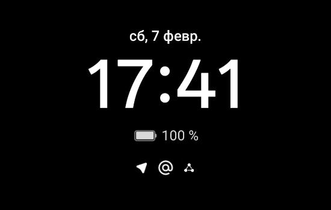
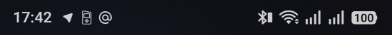

# ColorOS Material Icons

LSPosed module that brings back Material-style notification icons on OxygenOS / ColorOS 16 and ColorOS 17.

The stock firmware replaces each notification's monochrome small icon with the colored app icon everywhere. This module restores the standard Android behavior:

| Area | Stock | With the module |
|---|---|---|
| Status bar | Colored app icons | Monochrome small icons, tinted light or dark to match the background |
| Notification shade | Colored app icons | Colored app icons that follow your launcher icon theme |
| Always-On Display | Colored app icons | Monochrome white silhouettes |






## Features

- **Per-area switches** - status bar, notification shade and AOD can be turned on and off separately.
- **Icon-theme aware shade** - shade icons match the launcher under any icon theme, including themed (Material You) icons, and follow wallpaper colors and light/dark mode.
- **Custom icons for system apps** - built-in Material icons for apps whose own small icons are missing or poor: Messages, Battery, Phone Manager, Clock, Downloads, System update and missed calls. Each app and notification category has its own switch.
- **Custom icons per notification category** - assign your own icon (Vector Drawable XML or SVG) to any notification category of any app, with separate icons for the status bar, the shade and AOD.
- **Built into system Settings** - no separate app to open; no root required for the settings or for custom icons.

## Requirements

- OxygenOS 16, ColorOS 16 or ColorOS 17
- LSPosed or a compatible fork, Xposed API 93+

## Installation

1. Download the APK from [Releases](https://github.com/ValanisZz/oxygenos-material-statusbar/releases) and install it.
2. Enable the module in LSPosed and keep the recommended scope:

   | Package | Why |
   |---|---|
   | `android` | Stops the system from replacing the small icon |
   | `com.android.systemui` | Status bar, notification shade, AOD |
   | `com.oplus.aod` | AOD when it runs as a separate process |
   | `com.android.settings` | Module settings screen |
   | `com.oplus.notificationmanager` | Per-category icon picker |

3. Reboot.

After updating the module, reboot again: restarting SystemUI alone does not load the new version.

## Settings

Open **Settings -> Material icons** (right below *Notifications & quick settings*).

| Option | Default | Effect |
|---|---|---|
| Enable SystemUI injection | On | Master switch for the whole module |
| Status Bar | On | Monochrome icons in the status bar |
| Notification Shade | On | Colored app icons in the shade |
| Always on Display | On | Monochrome icons on AOD |
| Custom icons for notification categories | Off | Adds an icon picker to every app's notification category screen |
| Custom icons for system apps | On | Built-in Material icons, with per-app and per-category switches |

Use **Apply changes and restart SystemUI** on the same screen to apply.

### Custom icon for a notification category

1. Turn on **Custom icons for notification categories**.
2. Open the app's notification settings and pick a category.
3. In the **Icon** section, enable **Custom icon** and choose a file for the main icon. Optionally set separate icons for the notification shade and AOD.
4. Restart SystemUI from the module settings.

Supported files: Android Vector Drawable (`.xml`) and SVG. **Reset** returns the category to its default icon.

## How it works

| Process | What the module does |
|---|---|
| `system_server` | Blocks `OplusNotificationFixHelper.fixSmallIcon`, which swaps the small icon for the app icon. Also drops repeated identical updates of ongoing notifications. |
| SystemUI - status bar | Hooks `IconManager.getIconDescriptor` and supplies the original small icon, loaded without the system icon theme so it stays tintable. |
| SystemUI - shade | Replaces the header icon with the app icon when the notification is bound and repaints it to match the launcher icon theme. On ColorOS 17 the icon is supplied through the row icon provider instead, so it is correct from the first frame. |
| SystemUI / `com.oplus.aod` - AOD | Makes the AOD engine take its small-icon path and converts icons to white silhouettes. |
| Settings / Notification manager | Injects the module entry, the settings screen and the per-category icon picker. |

Icons that are not monochrome are converted: the alpha mask is kept for transparent icons, and a silhouette is extracted by contrast for opaque ones.

Settings are stored in `Settings.Global` under the `oxygen_material_` prefix. Custom category icons are stored inside the module and served to SystemUI through a content provider.

## Building

Requirements: JDK 24 (toolchain), Android SDK with platform 36.

```bash
./gradlew :app:assembleDebug
./gradlew :app:assembleRelease
```

The release signing config reads these environment variables. `VALANIS_JKS_STORE_FILE` must point to an existing file even for debug builds:

- `VALANIS_JKS_STORE_FILE`
- `VALANIS_JKS_STORE_PASSWORD`
- `VALANIS_JKS_KEY_ALIAS`
- `VALANIS_JKS_KEY_PASSWORD`

## Troubleshooting

The module writes to the LSPosed log with the tag `OxygenOSMaterialIcons`. At boot it logs one line per process listing every hook and whether it was installed:

```
OxygenOSMaterialIcons hooks[systemui] sdk=... build=...: failed=0/N +hook, +hook, ...
```

A hook marked with `-` was not found on your firmware; include this line when reporting a problem.

```bash
adb logcat -s OxygenOSMaterialIcons:V XposedBridge:V
```

To log which icon each notification received and why:

```bash
adb shell settings put global oxygen_material_debug_log 1   # 0 to turn off
```
